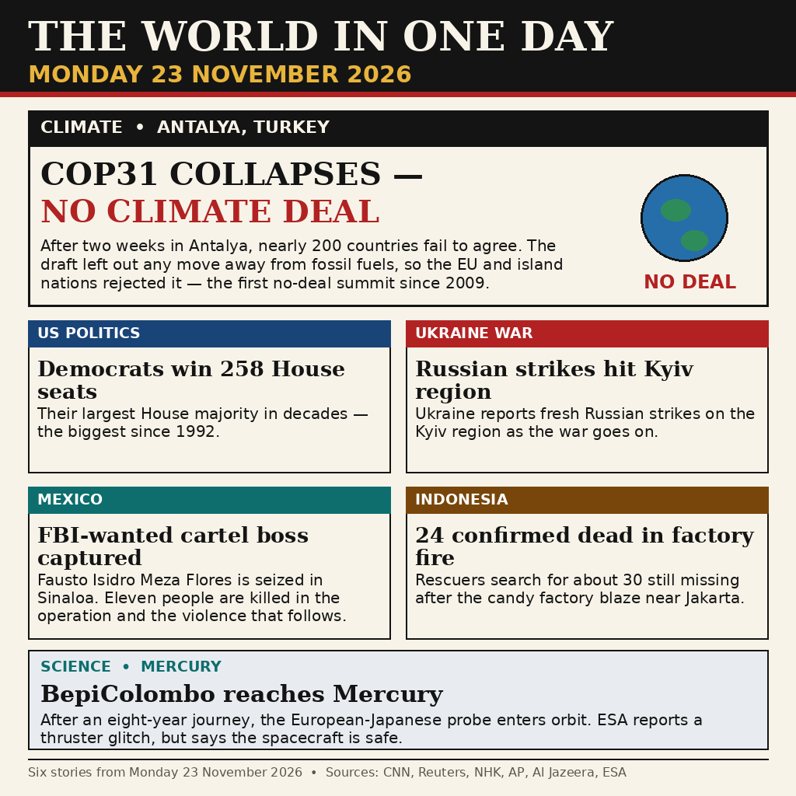

# The World in One Day — Monday 23 November 2026

[](https://make.fun/bounty/news-image-20261123?utm_source=github&utm_medium=readme&utm_campaign=news-image-20261123)
[](https://make.fun/bounty/news-image-20261123/leaderboard?utm_source=github&utm_medium=readme&utm_campaign=news-image-20261123)
[](https://make.fun/bounty/news-image-20261123?utm_source=github&utm_medium=readme&utm_campaign=news-image-20261123)

Entry for the [make.fun](https://make.fun/bounty/news-image-20261123) competition `news-image-20261123`: a program that
draws, entirely in code, a newspaper front page summing up the world's
news of Monday 23 November 2026.



## The image

A dense newspaper front page drawn in code with exact text (no
AI-generated text), in the format of the day's top entries: masthead,
numbers strip, UTC timeline, region legend, 13 main stories, 23 more
in the ALSO list, a world map with numbered pins, and a DATE CHECK
box. **36 stories in all, every one of them visible in the image.**

Main stories:

1. **COP31 collapses — no climate deal** (Antalya, Turkey)
2. **Russia fires 186 drones** — 161 downed; at least 10 killed in Dymer
3. **Bahrain demands Iran pay for strikes** — Manama urges UN action
4. **Democrats win 258 House seats** — largest majority since 1992
5. **'El Chapo Isidro' captured** — cartel boss seized in Sinaloa; 11 killed
6. **Factory fire: 24 dead, ~30 missing** — candy plant in Cikande, Indonesia
7. **BepiColombo reaches Mercury** — after an eight-year journey
8. **AI sell-off rattles markets** — Nikkei -5.06%, S&P 500 -3.7%
9. **Alcaraz wins ATP Finals** — beats Zverev 6-2, 7-6
10. **India declare on 720/9** — Wellington Test drawn
11. **Márquez wins 8th MotoGP title**
12. **Nvidia faces a reported SEC probe** — amid fallout from Huang's exit
13. **France arrests 144** — in cost-of-living protests

Plus 23 more in the ALSO list (South Sudan, Bolsonaro, Khartoum,
Istanbul, Houthis, EU-Rwanda centres, California, S. Korea, Seattle,
Belgium, Tata Steel, DR Congo Ebola, Nigeria, Mariana Trench,
Princess of Wales, Boca Juniors, darts, Nepal, India-China talks,
Russian warship off Libya (REPORTED), Loss & Damage Fund, US spy
chief on the Putin remark, Australia).

## Corrections to earlier drafts

Three stories in earlier drafts were dated to 23 November but do not
belong to that day, so they were re-checked against live reporting
and replaced:

* **Nvidia chief Huang resigned on 12 November**, not 23 November
  (Al Jazeera, 12 Nov 2026), amid an affairs/spy scandal — not a
  chip-sale probe. Panel 12 now reports the SEC probe first reported
  on 23 November (Trefis, 23 Nov 2026), labelled as reported.
* **The Iran/Bahrain radar claim was made on 21–22 November**
  (strike Saturday 21 Nov; claim and denial reported Sunday 22 Nov).
  Panel 3 now reports Bahrain's demand for compensation and UN
  action, first reported on 23 November (MENAFN, 23 Nov 00:53 GMT).
* **Trump called Putin "my friend" at Shenzhen on 19 November**
  (APEC trilateral, Al Jazeera 19 Nov 2026). The ALSO item now
  reports the US intelligence chief defending the remark, reported
  on 23 November (Al Jazeera, 23 Nov 2026).

Every other figure is as reported on 23 November 2026 (Reuters, BBC,
AP, Al Jazeera, AFP, OneTurn's 23 Nov digest). Claims that are
unconfirmed are labelled REPORTED where shown.

## How it runs

`main.py` (Python 3.13, standard library only, no network) draws the
whole page itself — a hand-written single-stroke vector font, flat
vector scenes, and a simplified world map — and writes a 1024×1024
PNG (about 74 KB) to `$MAKEFUN_OUTPUT_DIR/entry.png` (or
`/output/entry.png`). It has no clock and no unseeded randomness, so
every run writes the same bytes. Before saving it checks that every
piece of text sits inside its box, that no two text boxes overlap,
that no map pins collide, and that the PNG is under 1 MiB.

```sh
mkdir -p out && MAKEFUN_OUTPUT_DIR=out python3 main.py
```

Verified: two runs write byte-identical output
(sha256 `acebe9b72999dec91ada25c4f670e1be4dbf404c7e817613e9f45655e1e2ffd5`,
74,366 bytes, 1024×1024, ~0.7 s per run).

## License

MIT — see `LICENSE`.
